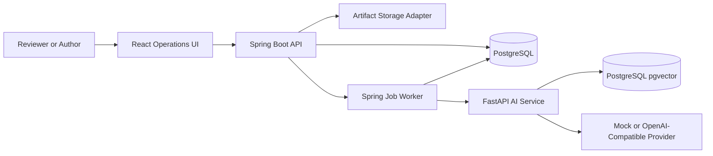
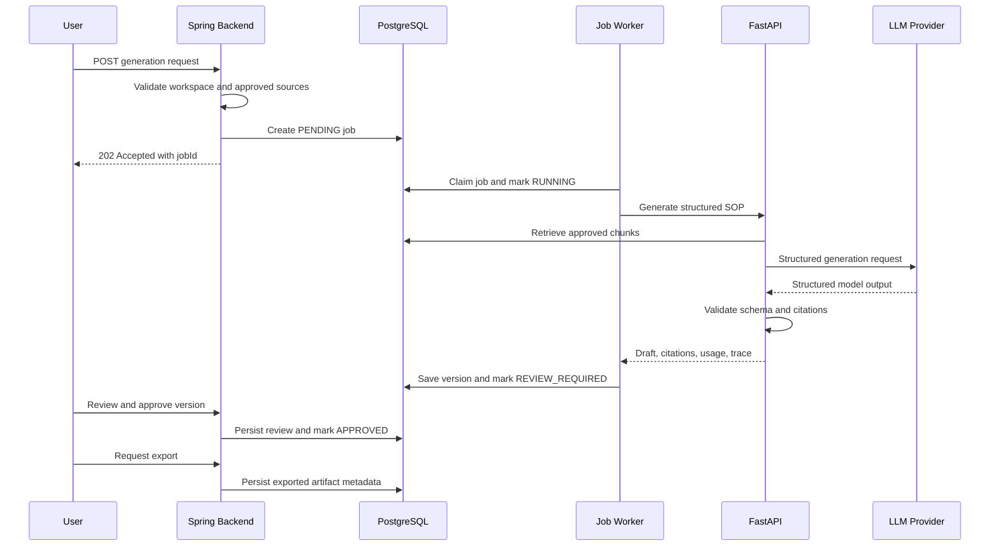

# FlowForge AI Flagship Implementation Plan

Status: Active — Phase 0 complete

Last updated: 2026-07-25

Target: Portfolio-grade public release demonstrating a complete AI-assisted document workflow and production-oriented architecture.

## 1. Objective

Turn FlowForge AI from a public-safe architecture scaffold into a working reference product that demonstrates how AI can solve a real operational problem:

> Convert fragmented process knowledge into validated, retrieval-grounded, reviewable, and exportable standard operating procedures.

The flagship value must come from a complete workflow, not from the number of technologies or diagrams in the repository.

The final system must prove that it can:

1. Accept process source material.
2. Validate required business inputs before generation.
3. Retrieve only approved source context.
4. Generate a structured draft through either a mock or real LLM provider.
5. Record citations, prompt version, provider usage, latency, and failures.
6. Process generation asynchronously.
7. Allow a human to edit, approve, or request changes.
8. Preserve immutable generation and review history.
9. Export the approved artifact.
10. Run locally through one documented setup path with no private data.

## 2. Current Baseline

### Implemented

- Spring Boot backend with validation, standard response envelopes, OpenAPI, and security boundaries.
- FastAPI AI service with prompt rendering, mock generation, retrieval interfaces, and workflow diagram generation.
- Backend-to-AI HTTP integration with timeout, retry/backoff, error mapping, and correlation ID propagation.
- PostgreSQL/JPA persistence for generated documents, workflow diagrams, and generation-job metadata.
- Deterministic local generation for tests and offline demos.
- In-memory retrieval and a pgvector adapter implementation.
- Versioned prompt files.
- Backend unit/controller tests, FastAPI tests, and a PostgreSQL Testcontainers test.
- Docker Compose and GitHub Actions.

### Known Gaps

- Generation jobs are synchronous lifecycle records, not worker-processed jobs.
- Generated content has no immutable version history.
- There is no source ingestion or source approval workflow.
- Citations and retrieval provenance are not persisted as first-class records.
- There is no human review workflow.
- There is no frontend.
- There is no document export workflow.
- Security is disabled by default and secured-mode behavior needs hardening.
- There is no full Docker system test covering backend, AI service, and PostgreSQL together.

## 3. Product Scope

### Primary User

An operations, compliance, quality, or internal-platform professional who maintains SOPs from scattered notes, policies, workflow descriptions, and previous documentation.

### Primary Workflow

The first complete workflow is SOP generation and review.

```text
Create workspace
-> add source material
-> approve source material
-> request SOP generation
-> process generation job
-> inspect draft and citations
-> edit draft
-> approve or request changes
-> export approved version
-> inspect generation and review history
```

### Supported Input for the Flagship Release

- Pasted process notes.
- Markdown or plain-text files.
- PDF files containing selectable text.
- Optional tags and source metadata.

DOCX ingestion can follow after the first release if it does not delay the complete workflow.

### Supported Output

- Structured SOP stored as validated JSON plus rendered Markdown.
- Markdown export.
- PDF export.
- DOCX export after Markdown and PDF are stable.

### Explicit Non-Goals

- Autonomous agents that make approval decisions.
- Unbounded tool-using agents.
- Multiple remote LLM vendors in the first release.
- Kafka, Kubernetes, or multiple queue services without a demonstrated requirement.
- Production billing or subscription management.
- Real customer documents or credentials.
- A large template marketplace.
- Copying the full CET domain schema into FlowForge.

## 4. Architecture Principles

1. Spring Boot is the system of record for workspaces, sources, jobs, documents, reviews, exports, and audit events.
2. FastAPI owns prompt rendering, retrieval execution, provider calls, structured-output validation, and AI traces.
3. Deterministic validation runs before any paid or remote model call.
4. Only approved sources may be retrieved for generation.
5. AI output is always a draft until explicitly approved by a human.
6. Approved content is immutable; changes create a new version.
7. Every citation must resolve to a retrieved source chunk.
8. Mock mode remains fully functional for CI and public demos.
9. External calls occur outside long-running database transactions.
10. Architecture documentation must describe implemented behavior separately from planned behavior.

## 5. Target Architecture



### Service Ownership

#### Spring Boot

- Authentication and authorization.
- Organization and workspace boundaries.
- Source metadata and approval state.
- Generation request validation.
- Job creation, claiming, retry, cancellation, and terminal state.
- Document and version persistence.
- Human review and approval.
- Export orchestration and artifact metadata.
- Audit events.
- Public API and OpenAPI specification.

#### FastAPI

- Source extraction support where Python libraries are more appropriate.
- Chunking and embedding.
- Retrieval and reranking.
- Prompt registry and rendering.
- Provider selection.
- Structured-output parsing and validation.
- Citation validation against retrieved chunks.
- Token, latency, prompt, provider, and retrieval traces.

#### PostgreSQL

- Business records owned by Spring.
- AI retrieval chunks and vectors owned by the AI service.
- Job queue state.
- Document and review history.
- Audit and generation traces.

#### Artifact Storage

- Local filesystem adapter for the public release.
- Interface compatible with S3-style object storage later.
- PostgreSQL stores artifact metadata and paths, not large binary content.

## 6. Target Generation Sequence



## 7. State Models

### Generation Job Status

```text
PENDING
RUNNING
RETRY_SCHEDULED
REVIEW_REQUIRED
COMPLETED
FAILED
CANCELLED
```

Rules:

- `PENDING -> RUNNING` only when a worker successfully claims the job.
- `RUNNING -> RETRY_SCHEDULED` only for retryable failures.
- `RUNNING -> REVIEW_REQUIRED` after a valid document version is persisted.
- `REVIEW_REQUIRED -> COMPLETED` after approval.
- Terminal states are `COMPLETED`, `FAILED`, and `CANCELLED`.
- Invalid transitions must raise a domain error and emit an audit event.

### Document Version Status

```text
DRAFT
IN_REVIEW
CHANGES_REQUESTED
APPROVED
SUPERSEDED
```

### Source Status

```text
UPLOADED
PROCESSING
READY
APPROVED
REJECTED
FAILED
```

Only `APPROVED` sources may participate in retrieval.

## 8. Data Model

The exact migrations should evolve incrementally from the current schema.

### `organizations`

- `id`
- `name`
- `created_at`
- `updated_at`

For the public demo, seed one synthetic organization. Secured mode reads organization identity from JWT claims.

### `workspaces`

- `id`
- `organization_id`
- `name`
- `description`
- `status`
- `created_by`
- `created_at`
- `updated_at`

### `source_documents`

- `id`
- `organization_id`
- `workspace_id`
- `title`
- `source_type`
- `storage_path`
- `content_hash`
- `status`
- `approved_by`
- `approved_at`
- `failure_message`
- `created_at`
- `updated_at`

### `source_chunks`

- `id`
- `organization_id`
- `workspace_id`
- `source_document_id`
- `chunk_index`
- `content`
- `content_hash`
- `embedding_model`
- `embedding`
- `metadata_json`
- `created_at`

### `generation_jobs`

Evolve the existing generation job table with:

- organization and workspace ownership.
- job type.
- status enum.
- attempt count and maximum attempts.
- next attempt time.
- worker lease owner and lease expiration.
- idempotency key.
- requested model and prompt version.
- failure code and failure message.
- created, started, completed, and updated timestamps.

### `generated_documents`

Evolve the current table into the stable document identity:

- `id`
- `organization_id`
- `workspace_id`
- `title`
- `document_type`
- `current_version_id`
- `created_by`
- `created_at`
- `updated_at`

### `document_versions`

- `id`
- `document_id`
- `version_number`
- `status`
- `structured_content_json`
- `rendered_markdown`
- `source_job_id`
- `prompt_name`
- `prompt_version`
- `provider`
- `model`
- `input_tokens`
- `output_tokens`
- `latency_ms`
- `created_by`
- `created_at`

### `document_citations`

- `id`
- `document_version_id`
- `section_key`
- `source_document_id`
- `source_chunk_id`
- `quoted_text`
- `retrieval_score`
- `created_at`

### `review_decisions`

- `id`
- `document_version_id`
- `decision`
- `comments`
- `reviewed_by`
- `created_at`

Decisions are `APPROVE`, `REQUEST_CHANGES`, and `REJECT`.

### `audit_events`

- `id`
- `organization_id`
- `actor_id`
- `entity_type`
- `entity_id`
- `action`
- `correlation_id`
- `metadata_json`
- `created_at`

### `exported_artifacts`

- `id`
- `document_version_id`
- `format`
- `storage_provider`
- `storage_path`
- `content_type`
- `size_bytes`
- `checksum`
- `created_by`
- `created_at`

## 9. Public Backend API Plan

All endpoints remain under `/api/v1` and use the standard `ApiResponse<T>` envelope except binary downloads.

### Workspaces

- `POST /workspaces`
- `GET /workspaces`
- `GET /workspaces/{workspaceId}`
- `PATCH /workspaces/{workspaceId}`

### Sources

- `POST /workspaces/{workspaceId}/sources`
- `GET /workspaces/{workspaceId}/sources`
- `GET /sources/{sourceId}`
- `POST /sources/{sourceId}/approve`
- `POST /sources/{sourceId}/reject`
- `POST /sources/{sourceId}/reindex`

### Generation

- `POST /workspaces/{workspaceId}/generation-jobs`
- `GET /generation-jobs/{jobId}`
- `POST /generation-jobs/{jobId}/cancel`
- `POST /generation-jobs/{jobId}/retry`

The create endpoint returns `202 Accepted` and a job resource.

### Documents

- `GET /workspaces/{workspaceId}/documents`
- `GET /documents/{documentId}`
- `GET /documents/{documentId}/versions`
- `GET /documents/{documentId}/versions/{versionId}`
- `PATCH /documents/{documentId}/versions/{versionId}`

### Reviews

- `POST /documents/{documentId}/versions/{versionId}/submit-review`
- `POST /documents/{documentId}/versions/{versionId}/approve`
- `POST /documents/{documentId}/versions/{versionId}/request-changes`

### Exports

- `POST /documents/{documentId}/versions/{versionId}/exports`
- `GET /exports/{exportId}`
- `GET /exports/{exportId}/download`

### Audit and History

- `GET /workspaces/{workspaceId}/audit-events`
- `GET /documents/{documentId}/history`

List endpoints must support pagination and stable ordering.

## 10. Internal AI Service Contracts

### Provider Factory

Implement:

```text
create_provider(settings) -> AIProvider
```

Supported first-release values:

- `mock`
- `openai_compatible`

Unsupported values must fail at startup. Do not advertise providers that do not have an implementation.

### Generation Request

The internal generation request should contain:

- organization ID.
- workspace ID.
- document title and type.
- objective.
- approved source IDs.
- prompt name and version.
- provider and model selection.
- structured generation options.
- correlation ID.

### Structured Generation Response

Use a Pydantic model containing:

- title.
- objective.
- scope.
- ordered procedure steps.
- assumptions.
- risks.
- owners.
- review checklist.
- citations per section.
- retrieval trace.
- provider usage trace.
- warnings.

The provider must not return free-form Markdown as the primary contract. Markdown should be rendered from validated structured output.

### Citation Rules

- Every citation references a chunk retrieved for the current request.
- Unknown chunk IDs fail response validation.
- Quoted text must be a substring or normalized match of the referenced chunk.
- Sections without supporting context must be marked as assumptions, not facts.
- A generation response with invalid citations must not be persisted as reviewable output.

## 11. Configuration Plan

### Backend

```text
FLOWFORGE_SECURITY_ENABLED
AI_SERVICE_MODE
AI_SERVICE_BASE_URL
AI_SERVICE_TIMEOUT_MS
AI_SERVICE_RETRY_ATTEMPTS
AI_SERVICE_RETRY_BACKOFF_MS
JOB_WORKER_ENABLED
JOB_WORKER_POLL_INTERVAL_MS
JOB_WORKER_LEASE_SECONDS
ARTIFACT_STORAGE_PROVIDER
ARTIFACT_STORAGE_PATH
JWT_ISSUER_URI
JWT_AUDIENCE
```

### AI Service

```text
LLM_PROVIDER
LLM_API_KEY
LLM_BASE_URL
DEFAULT_MODEL
MODEL_TIMEOUT_SECONDS
RETRIEVAL_BACKEND
VECTOR_DB_URL
EMBEDDING_PROVIDER
EMBEDDING_MODEL
EMBEDDING_DIMENSIONS
```

Secrets must only come from runtime configuration. Readiness output must never expose secret values.

## 12. Implementation Phases

### Phase 0: Baseline Integrity

Goal: make the existing foundation internally consistent before extending it.

### Tasks

- [x] Replace raw job/document status strings with enums.
- [x] Define valid job state transitions in the domain entity.
- [x] Separate short database transactions from external AI calls.
- [x] Persist failed job state without masking the original exception.
- [x] Add tag-list size validation and normalize null tags.
- [x] Remove unsupported provider names from configuration until adapters exist.
- [x] Make readiness report the instantiated provider and retriever.
- [x] Reconcile README, architecture, AI design, roadmap, and implemented behavior.
- [x] Add Maven Wrapper.

### Transaction Pattern

1. Create job in a short transaction.
2. Call the AI service outside the transaction.
3. Save output and complete the job in one transaction.
4. Mark failure in an independent transaction.

### Tests

- Job transition unit tests.
- Resource-save failure tests.
- Job-completion failure tests.
- Original-exception preservation tests.
- Readiness configuration tests.

### Exit Criteria

- Existing tests pass.
- No partial successful resource can remain attached to an incorrectly running job.
- Documentation no longer labels extension points as implemented features.

### Phase 1: Workspace and Source Foundation

Goal: introduce the minimum business model needed for a real generation workflow.

### Tasks

- [ ] Add organization and workspace migrations/entities/repositories/services/controllers.
- [ ] Add source document metadata and source status transitions.
- [ ] Implement text and Markdown upload.
- [ ] Implement PDF text extraction with size and page limits.
- [ ] Add content hashing and duplicate detection.
- [ ] Add source approval and rejection.
- [ ] Add local filesystem storage adapter.
- [ ] Add organization ownership to all new queries.
- [ ] Seed only synthetic demo records.

### Tests

- Tenant isolation repository tests.
- File type and size validation tests.
- Duplicate source tests.
- Source approval transition tests.
- Malformed PDF and empty-content tests.

### Exit Criteria

- A user can create a workspace, upload source material, and approve it.
- Unapproved sources cannot be selected for generation.

### Phase 2: Real Provider and Structured Output

Goal: support both deterministic CI and real bring-your-own-key generation.

### Tasks

- [ ] Add provider factory.
- [ ] Keep `MockAIProvider` as the default.
- [ ] Implement one OpenAI-compatible provider adapter.
- [ ] Add provider-specific HTTP timeout and error mapping.
- [ ] Use provider-native structured output when available.
- [ ] Validate all output through Pydantic.
- [ ] Record token use, model, provider, prompt version, and latency.
- [ ] Reject unsupported provider configuration during startup.
- [ ] Redact provider errors before returning public API responses.

### Tests

- Mock provider regression tests.
- Provider factory tests.
- Mocked HTTP success, timeout, rate-limit, malformed JSON, and invalid-schema tests.
- Token/latency trace mapping tests.
- No real credentials or paid calls in CI.

### Exit Criteria

- Mock mode and real provider mode use the same structured contract.
- A developer can supply a key locally and generate a real structured SOP.
- CI remains fully deterministic without a provider key.

### Phase 3: Runtime RAG and Provenance

Goal: ground generation in approved source material and make retrieval inspectable.

### Tasks

- [ ] Add source chunking with stable chunk IDs.
- [ ] Add embedding adapter selection.
- [ ] Wire `RETRIEVAL_BACKEND` to a retriever factory.
- [ ] Make pgvector the Docker Compose integration path.
- [ ] Index approved sources and delete/rebuild chunks on reindex.
- [ ] Filter by organization, workspace, source status, tags, and source IDs.
- [ ] Add optional lightweight reranking.
- [ ] Return retrieval scores and selected chunks.
- [ ] Persist citations and retrieval traces.
- [ ] Make retrieval failure explicit; do not silently invent context.

### Tests

- Chunk determinism tests.
- pgvector Testcontainers retrieval tests.
- Tenant/source filter tests.
- Reindex and deletion tests.
- Vector failure and empty-result tests.
- Citation-to-retrieved-chunk validation tests.

### Exit Criteria

- Generation uses only approved source chunks.
- Every factual citation resolves to persisted provenance.
- The UI/API can show which source content supported each section.

### Phase 4: Asynchronous Job Processing

Goal: turn job records into a real recoverable processing system.

### Initial Queue Choice

Use PostgreSQL as the queue for the first flagship release. Claim work with row locking and `SKIP LOCKED`, plus a lease expiration. This avoids adding queue infrastructure before workload requires it.

### Tasks

- [ ] Return `202 Accepted` from generation requests.
- [ ] Implement scheduled worker polling.
- [ ] Atomically claim one pending/retryable job.
- [ ] Add attempt count and exponential retry schedule.
- [ ] Distinguish retryable and terminal failures.
- [ ] Add worker lease and stale-job recovery.
- [ ] Add idempotency keys.
- [ ] Add cancellation before terminal state.
- [ ] Persist successful version and transition to `REVIEW_REQUIRED` atomically.
- [ ] Add graceful worker shutdown.

### Tests

- Concurrent worker claim tests.
- Duplicate/idempotent request tests.
- Retry scheduling tests.
- Lease-expiration recovery tests.
- Cancellation race tests.
- End-to-end async polling test.

### Exit Criteria

- API requests do not block on model latency.
- Duplicate submissions do not create duplicate generation work.
- Jobs recover after worker interruption.

### Phase 5: Versioning, Review, and Audit

Goal: make AI output governable and safe for operational use.

### Tasks

- [ ] Split stable document identity from immutable document versions.
- [ ] Store structured JSON and rendered Markdown per version.
- [ ] Add edit operation that creates or updates a draft version according to documented rules.
- [ ] Add submit-for-review action.
- [ ] Add approve and request-changes actions.
- [ ] Prevent edits to approved versions.
- [ ] Add regeneration as a new version.
- [ ] Persist review decisions and comments.
- [ ] Add audit events for every state-changing action.
- [ ] Include actor and correlation ID in audit records.

### Tests

- Version numbering and immutability tests.
- Invalid review transition tests.
- Approved-version modification tests.
- Regeneration history tests.
- Audit completeness tests.
- Role authorization tests.

### Exit Criteria

- No AI output becomes final without a review decision.
- Every approved artifact has a traceable source version, generation job, and reviewer.

### Phase 6: Operational Frontend and Export

Goal: make the product demonstrable without Swagger or manual API calls.

### Frontend Views

- [ ] Workspace list and creation.
- [ ] Workspace detail with source and document tabs.
- [ ] Source upload, status, approve, reject, and reindex controls.
- [ ] Generation form with approved-source selection.
- [ ] Job progress and retry/cancel controls.
- [ ] Document editor with structured section navigation.
- [ ] Citation/source side panel.
- [ ] Review comments and approval controls.
- [ ] Version history comparison.
- [ ] Export menu and artifact history.

### Frontend Technology

- React and TypeScript.
- TanStack Query for server state.
- Existing API contracts generated or typed centrally.
- Mermaid rendering for workflow artifacts.
- Route-level code splitting.
- Accessible forms, keyboard operation, and responsive layouts.

### Export Tasks

- [ ] Render approved structured output to canonical Markdown.
- [ ] Add Markdown download.
- [ ] Add deterministic PDF generation.
- [ ] Add DOCX generation after PDF is stable.
- [ ] Persist artifact checksum, size, content type, and storage path.
- [ ] Refuse final export for unapproved versions unless explicitly labeled `DRAFT`.

### Tests

- Frontend component tests for primary states.
- Playwright happy-path workflow.
- Export snapshot/content tests.
- Download authorization tests.
- Visual checks at desktop and mobile sizes.

### Exit Criteria

- A reviewer can complete the entire workflow through the UI.
- The exported artifact identifies its version, approval state, and citations.

### Phase 7: Security, Reliability, and Observability

Goal: demonstrate production-oriented operational controls.

### Security Tasks

- [ ] Enforce JWT issuer and audience.
- [ ] Require roles in secured mode; remove default-role escalation.
- [ ] Add `AUTHOR`, `REVIEWER`, and `ADMIN` role rules.
- [ ] Enforce organization ownership in service and repository queries.
- [ ] Make log masking case-insensitive.
- [ ] Add request and file-size limits.
- [ ] Add per-user/organization generation rate limiting.
- [ ] Validate filenames and prevent path traversal.
- [ ] Add dependency and secret scanning.
- [ ] Document the threat model.

### Reliability Tasks

- [ ] Add bounded retry with jitter for AI calls.
- [ ] Add circuit breaker only after retry behavior is measured.
- [ ] Add database and AI readiness checks.
- [ ] Add graceful degradation when the real provider is unavailable.
- [ ] Add backup/restore documentation for metadata and local artifacts.

### Observability Tasks

- [ ] Add Micrometer metrics for job counts, durations, retries, and failures.
- [ ] Add AI metrics for provider latency, token use, and schema failures.
- [ ] Add retrieval metrics for empty results and selected chunk counts.
- [ ] Propagate correlation ID across UI, backend, worker, and AI service.
- [ ] Add structured JSON logs.
- [ ] Add a local Grafana/Prometheus profile or documented dashboard screenshots.
- [ ] Define service-level indicators and initial targets.

### Exit Criteria

- Secured-mode tests cover invalid audience, missing roles, cross-organization access, and unauthorized review/export.
- An operator can identify a failed generation using job ID or correlation ID.

### Phase 8: Quality Gates, Evaluation, and System Proof

Goal: make repository claims defensible through repeatable evidence.

### CI Quality Gates

- [ ] Java formatting with Spotless.
- [ ] Java static analysis with SpotBugs.
- [ ] Java coverage with JaCoCo.
- [ ] Python formatting/linting with Ruff.
- [ ] Python type checking with Pyright or mypy.
- [ ] Python coverage.
- [ ] Frontend lint, type check, unit tests, and build.
- [ ] gitleaks secret scanning.
- [ ] Dependency review.
- [ ] Container image scanning.

### Contract and System Tests

- [ ] Backend-to-AI WireMock contract tests.
- [ ] AI route and structured-schema tests.
- [ ] PostgreSQL/pgvector Testcontainers tests.
- [ ] Docker Compose smoke test.
- [ ] Full workflow test: upload -> approve -> generate -> review -> approve -> export.
- [ ] Timeout, malformed response, provider failure, vector failure, and database failure tests.

### Evaluation Dataset

Create 20 to 30 synthetic fixtures covering:

- Sequential procedures.
- Branching approval workflows.
- Missing owners.
- Conflicting source notes.
- Unsupported claims.
- Empty retrieval results.
- Multiple relevant sources.
- Irrelevant or rejected sources.
- Long inputs near limits.
- Injection-like instructions inside source documents.

### Evaluation Metrics

- Required-section completion rate.
- Citation validity rate.
- Unsupported-claim rate.
- Retrieval precision at K.
- Empty-retrieval rate.
- Structured-output schema success rate.
- Job success/retry/failure rate.
- Generation latency distribution.
- Token consumption per document.
- Draft-to-approval time in the demo workflow.

Only publish measured results. Do not invent performance improvements or production usage.

### Exit Criteria

- A clean clone passes CI.
- Docker Compose starts the complete local system.
- The full synthetic workflow passes automatically.
- Evaluation results are versioned and reproducible.

## 13. Recommended Milestone Schedule

This is an approximate solo-development sequence. Adjust based on measured complexity.

| Milestone | Scope | Suggested Duration |
| --- | --- | --- |
| M0 | Baseline integrity and documentation | 2-4 days |
| M1 | Workspaces, sources, approval, storage | 1-2 weeks |
| M2 | Real provider and structured output | 1 week |
| M3 | Runtime pgvector RAG and citations | 1-2 weeks |
| M4 | Database-backed async worker | 1 week |
| M5 | Versioning, review, and audit | 1-2 weeks |
| M6 | Frontend and exports | 2 weeks |
| M7 | Security and observability | 1 week |
| M8 | System tests, evaluation, and showcase | 1 week |

Each milestone should be a reviewable pull request or small sequence of pull requests. Avoid one large final merge.

## 14. Pull Request Strategy

Suggested pull request sequence:

1. `refactor: enforce generation job state transitions`
2. `feat: add workspaces and source document lifecycle`
3. `feat: add provider factory and OpenAI-compatible adapter`
4. `feat: index approved sources with pgvector`
5. `feat: add grounded SOP generation with citations`
6. `feat: process generation jobs asynchronously`
7. `feat: add immutable document versions and review decisions`
8. `feat: add workspace and review frontend`
9. `feat: export approved documents`
10. `security: enforce tenant and reviewer authorization`
11. `test: add full system workflow and evaluation suite`
12. `docs: publish flagship architecture and measured results`

Every pull request should include:

- Problem statement.
- Behavioral change.
- Architecture impact.
- Migration impact.
- Security considerations.
- Tests executed.
- Screenshots for UI changes.
- Documentation updates.

## 15. Definition of Done

The flagship release is complete when all of the following are true:

- [ ] A clean clone starts through documented commands.
- [ ] Mock mode works without credentials.
- [ ] A real provider works with a user-supplied key.
- [ ] Runtime configuration selects the actual provider and retriever.
- [ ] A user can create a workspace and upload source material.
- [ ] Only approved sources are retrieved.
- [ ] Generation returns immediately as an asynchronous job.
- [ ] Failed and interrupted jobs recover according to policy.
- [ ] Generated output passes a structured schema.
- [ ] Citations resolve to approved source chunks.
- [ ] A human can edit, request changes, and approve a version.
- [ ] Approved versions are immutable.
- [ ] Markdown and PDF exports work.
- [ ] Audit history covers generation, review, and export.
- [ ] Cross-organization access is rejected in secured mode.
- [ ] Backend, AI, frontend, container, and system tests pass in CI.
- [ ] Evaluation metrics are published from synthetic fixtures.
- [ ] README accurately separates implemented features from roadmap items.
- [ ] A short demo shows the complete workflow.

## 16. Portfolio Deliverables

### GitHub

- Product-focused README.
- Current architecture diagram.
- Generation and review sequence diagram.
- Implemented-versus-planned table.
- One-command local setup.
- Synthetic demo data.
- Screenshots and a short demo video.
- CI, coverage, and security badges.
- ADRs for major tradeoffs.
- Published evaluation report.

### Architecture Decision Records

Create ADRs for:

1. Spring Boot as system of record.
2. FastAPI as AI orchestration boundary.
3. PostgreSQL-backed queue before external queue infrastructure.
4. Structured provider output instead of free-form Markdown contracts.
5. Human approval before final export.
6. pgvector and metadata-first retrieval.
7. Local storage adapter with future object-storage compatibility.
8. Mock-first deterministic CI plus optional real provider.

### Demo Script

The demo should take less than five minutes:

1. Open a synthetic workspace.
2. Upload two process sources.
3. Approve one and leave one rejected.
4. Request SOP generation.
5. Show asynchronous job state.
6. Open the generated draft.
7. Inspect citations proving the rejected source was not used.
8. Edit one section and request review.
9. Approve the version.
10. Export PDF and inspect audit history.

### Resume Evidence

Resume bullets should be based on implemented and measured behavior, for example:

- Designed and built a Spring Boot and FastAPI platform that converts process source material into retrieval-grounded SOP drafts with asynchronous processing, citations, human approval, and export workflows.
- Implemented pgvector retrieval, provider abstraction, prompt versioning, immutable document versions, tenant-scoped persistence, retry handling, and end-to-end audit traces.
- Built contract, container, security, and AI-evaluation suites covering service integration, retrieval quality, citation correctness, and generation failure paths.

Replace generic claims with measured results once the evaluation suite exists.

## 17. Risks and Mitigations

| Risk | Mitigation |
| --- | --- |
| Scope grows into a generic document platform | Keep SOP generation as the only required flagship workflow. |
| Real provider makes tests flaky or expensive | Use mock HTTP/provider contracts in CI and real calls only in an opt-in profile. |
| Database queue becomes complex | Implement bounded claiming, leases, retries, and metrics; document when an external queue becomes justified. |
| RAG returns irrelevant content | Require approved sources, metadata filters, evaluation fixtures, and visible citations. |
| Model invents unsupported facts | Validate citations, separate assumptions, and require human approval. |
| Schema expands faster than behavior | Add tables only in the milestone that uses them end to end. |
| Security claims exceed implementation | Keep security tests and implemented-versus-planned documentation current. |
| Frontend delays backend completion | Start UI only after stable workspace, source, job, document, and review contracts. |
| Export rendering becomes platform-specific | Use an adapter and test deterministic output in the container environment. |
| Public repository exposes sensitive material | Use synthetic fixtures, secret scanning, and documented data guardrails. |

## 18. Immediate Next Actions

Complete these actions before starting major feature work:

1. Create issues for Phase 0 tasks.
2. Replace status strings with enums and enforce transitions.
3. Implement explicit transaction boundaries for job success and failure.
4. Correct readiness and configuration claims.
5. Add the Maven Wrapper.
6. Update `roadmap.md` so completed work is not repeated as pending work.
7. Create ADR 001 for Spring/FastAPI ownership.
8. Open the first focused pull request for baseline integrity.

The first new product milestone after baseline integrity is workspace and approved-source management, followed by real structured provider integration.
